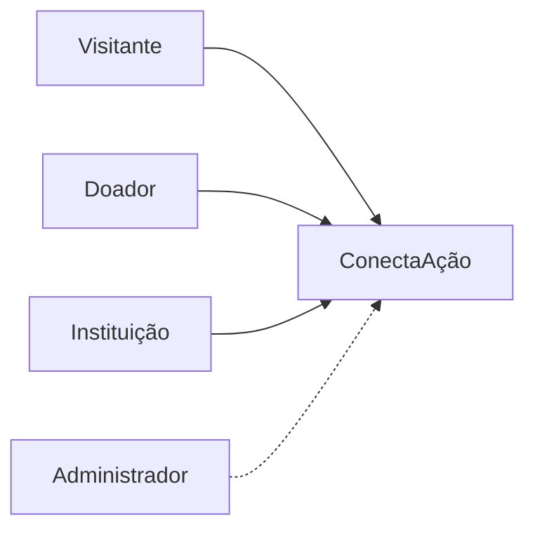
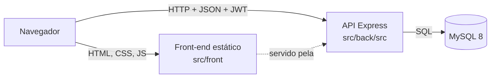
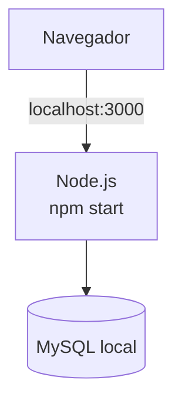

# Arquitetura de software

> **Artefato central da Sprint 6.** Mostra como a aplicação se organiza como um todo: as partes, o que cada uma faz e como se comunicam. As decisões internas do back-end estão em [`decisoes-de-projeto.md`](../projeto/decisoes-de-projeto.md) e [`padroes-de-projeto.md`](../padroes/padroes-de-projeto.md).

## 1. Visão geral

**Estilo arquitetural:** cliente-servidor. O servidor é um monólito em camadas.

**Justificativa:**

- O domínio é pequeno e coeso: doadores, instituições, necessidades e doações.
- Nenhuma parte precisa escalar ou ser publicada separadamente.
- A regra de saldo (`RNF-06`) precisa de uma transação local, o que é simples com um banco só.
- Um único processo facilita rodar, testar e demonstrar.

## 2. Diagrama de contexto



**Descrição:** o sistema não usa serviços externos. Não há pagamento (`RNF-05`) nem envio de e-mail. O administrador está pontilhado porque a verificação de instituições (`RF-11`) ainda não tem tela.

## 3. Diagrama de contêineres e componentes



Dentro da API, a requisição passa por `routes → middleware → controllers → services → repositories → MySQL`.

## 4. Componentes e responsabilidades

| Componente | Responsabilidade | Tecnologia | Diretório real | Comunicação |
|---|---|---|---|---|
| Front-end | Telas e validação dos formulários | HTML, CSS, JS | [`src/front/`](../../src/front/) | Chama a API via `fetch` |
| Cliente da API | Único ponto que faz `fetch`; guarda o token | JS | [`src/front/js/api.js`](../../src/front/js/api.js) | HTTP na mesma origem |
| Servidor | Sobe o Express, serve o front, trata erros | Node.js, Express | [`server.js`](../../src/back/src/server.js) | HTTP, porta 3000 |
| Rotas e middleware | Ligam URL ao controller; validam o JWT | Express, jsonwebtoken | [`routes/`](../../src/back/src/routes/), [`middleware/`](../../src/back/src/middleware/) | Chamada de função |
| Controllers, services, repositories | HTTP, regra de negócio, SQL | JS | [`controllers/`](../../src/back/src/controllers/), [`services/`](../../src/back/src/services/), [`repositories/`](../../src/back/src/repositories/) | Chamada de função |
| Banco de dados | Guarda os dados e reforça regras com `UNIQUE` e `CHECK` | MySQL 8.0.16+ | [`schema.sql`](../../src/back/sql/schema.sql) | Pool `mysql2` |

### Interface entre front-end e API

| Rota | Acesso | Requisito |
|---|---|---|
| `POST /cadastro/doador` | Público | `RF-01` |
| `POST /cadastro/instituicao` | Público | `RF-02` |
| `POST /login` | Público | `RF-03` |
| `POST /logout` | Público | `RF-04` |
| `GET /instituicoes/destaques` | Público | `RF-06` |
| `GET /instituicoes` | Com token | `RF-05`, `RF-07` |
| `GET /instituicoes/:id` | Com token | `RF-10`, `RF-18` |
| `POST /doacoes` | Token de doador | `RF-19` |

Todo erro volta no formato `{ "erro": "mensagem" }`.

## 5. Decisões arquiteturais

### DA-01: Monólito em camadas

- **Contexto:** domínio pequeno, grupo pequeno, prazo de um semestre.
- **Decisão:** um processo Express com camadas. Microsserviços foram descartados.
- **Requisitos:** `RNF-06`, `RNF-08`.
- **Consequências:** fácil de rodar e depurar. Em troca, tudo escala junto e uma falha derruba a aplicação inteira.
- **Evidência:** [`src/back/src/`](../../src/back/src/)

### DA-02: Front-end servido pela própria API

- **Contexto:** o front precisava falar com a API.
- **Decisão:** o Express serve `src/front/` com `express.static`. A outra opção era um servidor separado com CORS.
- **Requisitos:** `RNF-09`.
- **Consequências:** um comando sobe tudo e não há CORS. Em troca, front e API não podem ser publicados em lugares diferentes sem rever a decisão.
- **Evidência:** [`server.js`](../../src/back/src/server.js), [`api.js`](../../src/front/js/api.js)

### DA-03: Autenticação com JWT

- **Contexto:** doador e instituição fazem login, e as rotas precisam saber quem é o usuário.
- **Decisão:** token JWT assinado, enviado no cabeçalho `Authorization`. O token informa o tipo de perfil, e o front usa isso para montar o menu de cada um.
- **Requisitos:** `RNF-03`, `RNF-04`.
- **Consequências:** o servidor não guarda sessão. Em troca, um token vazado vale até expirar (8h).
- **Evidência:** [`autenticacao.js`](../../src/back/src/middleware/autenticacao.js), [`authService.js`](../../src/back/src/services/authService.js)

### DA-04: Banco relacional único com transação

- **Contexto:** duas promessas ao mesmo tempo não podem passar do que falta.
- **Decisão:** MySQL com transação e `SELECT ... FOR UPDATE` no saldo.
- **Requisitos:** `RNF-06`, `RNF-07`.
- **Consequências:** o banco garante a regra mesmo com acessos simultâneos. Em troca, a aplicação depende do MySQL para rodar.
- **Evidência:** [`necessidadeRepository.js`](../../src/back/src/repositories/necessidadeRepository.js), [`doacaoService.js`](../../src/back/src/services/doacaoService.js)

## 6. Requisitos não funcionais e decisões

| RNF | Como é atendido | Decisão |
|---|---|---|
| `RNF-02` Responsividade | Layout testado de 390 px a 1366 px; alvos de 44 px | `DA-02` |
| `RNF-03` Segurança | Senha com bcrypt; JWT com segredo no `.env` | `DA-03` |
| `RNF-04` Privacidade | Listagem e detalhe exigem token | `DA-03` |
| `RNF-05` Sem pagamento | Nenhum serviço externo | `DA-01` |
| `RNF-06` Integridade | Transação com trava de linha | `DA-04` |
| `RNF-09` Compatibilidade | HTML, CSS e JS padrão, sem build | `DA-02` |

## 7. Implantação e execução



```bash
# 1. Execute src/back/sql/schema.sql no MySQL
cd src/back
cp .env.example .env    # preencha DB_* e JWT_SECRET
npm install
npm start               # abra http://localhost:3000
```

| Ambiente | Comando ou endereço | Finalidade |
|---|---|---|
| Local | `npm start` | Desenvolvimento e demonstração |
| Testes | `npm test` (não precisa de MySQL) | Verificação automática |
| Publicado | `[a definir]` | Demonstração online |

## 8. Riscos arquiteturais

| Risco | Probabilidade | Impacto | Mitigação | Issue |
|---|---|---|---|---|
| Demonstração depende de MySQL local | Média | Alta | `schema.sql` e `.env.example` no repositório | `[a criar]` |
| Banco sem causa e cidade da instituição | Alta | Média | Adicionar colunas antes de busca e filtros (`RF-08`, `RF-09`) | `[a criar]` |
| Services lançam erro HTTP | Média | Média | Separar erro de domínio | `T-15` |
| Validação de entrada espalhada | Média | Baixa | Centralizar validação | `T-16` |

## 9. Correspondência arquitetura × código

| Elemento do diagrama | Evidência no código |
|---|---|
| Front-end estático | [`index.html`](../../src/front/index.html), [`pages/login.html`](../../src/front/pages/login.html) |
| Cliente da API | [`js/api.js`](../../src/front/js/api.js) |
| API Express | [`server.js`](../../src/back/src/server.js) |
| Camadas da API | [`routes/`](../../src/back/src/routes/), [`controllers/`](../../src/back/src/controllers/), [`services/`](../../src/back/src/services/), [`repositories/`](../../src/back/src/repositories/) |
| MySQL | [`schema.sql`](../../src/back/sql/schema.sql), [`config/db.js`](../../src/back/src/config/db.js) |
