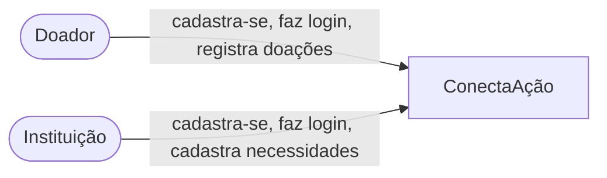
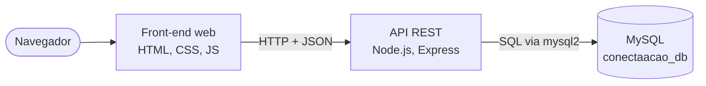
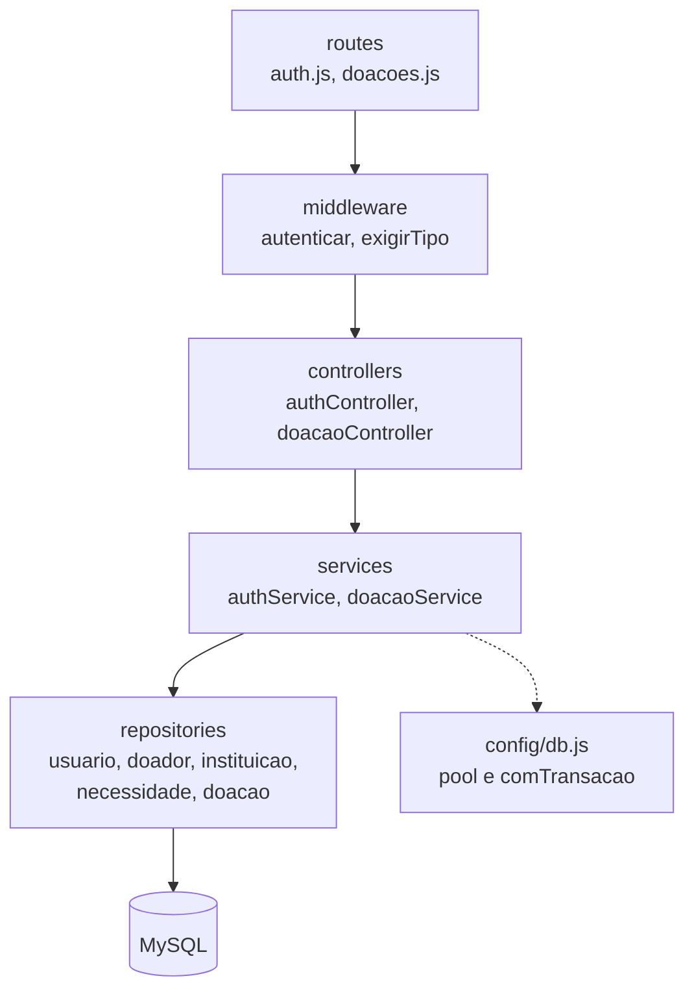
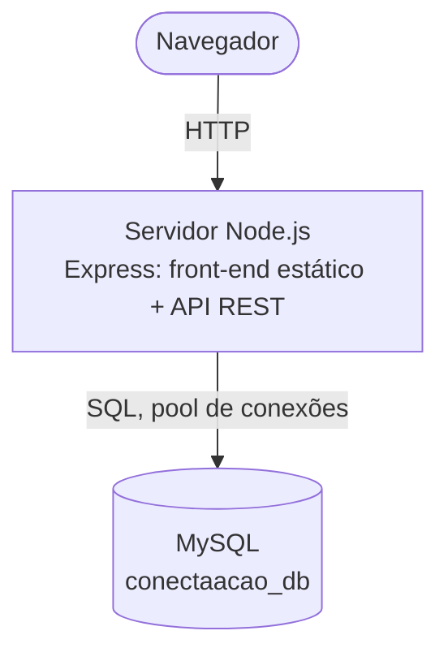

# Arquitetura de software

> **Artefato central da Sprint 6.** Mostra como a aplicação se organiza como um todo: as partes, o que cada uma faz e como se comunicam. As decisões internas do back-end estão em [`decisoes-de-projeto.md`](../projeto/decisoes-de-projeto.md) e [`padroes-de-projeto.md`](../padroes/padroes-de-projeto.md).

## 1. Visão geral

**Estilo arquitetural:** cliente-servidor com API REST/JSON; o back-end é organizado em **camadas** (rotas → controllers → services → repositories → banco).

**Justificativa:** o ConectaAção conecta doadores a necessidades de instituições. As regras que mais importam (não doar mais do que falta, saldo consistente com várias doações simultâneas, acesso restrito por tipo de usuário) ficam concentradas no back-end, e o front-end apenas consome a API. A separação em camadas isola cada responsabilidade: o SQL fica nos repositories, as regras de negócio e transações nos services, e o HTTP nos controllers. Isso facilita testar e alterar uma parte sem mexer nas outras. A escolha atende aos atributos de qualidade de **consistência dos dados** (transação com trava de linha), **segurança** (JWT, senha com hash) e **manutenibilidade** (camadas com responsabilidade única).

## 2. Diagrama de contexto

**Descrição:** o ConectaAção é o único sistema do escopo e não depende de nenhum serviço externo (e-mail, pagamento, mapas etc.). Existem dois tipos de usuário, ambos autenticados por e-mail e senha:

- **Doador:** cria conta, faz login e registra doações para uma necessidade de uma instituição.
- **Instituição:** cria conta com seus dados e uma lista inicial de necessidades (item e quantidade), e acompanha seu perfil, incluindo se está verificada.

## 3. Diagrama de contêineres e componentes

### 3.1 Contêineres

### 3.2 Componentes da API

> Cada elemento aponta para um diretório ou módulo existente; veja a seção 8.

## 4. Componentes e responsabilidades

| Componente | Responsabilidade | Tecnologia | Diretório real | Comunicação |
|---|---|---|---|---|
| Front-end web | Telas de login, cadastro de doador e de instituição e registro de doação; guarda o token no navegador | HTML, CSS e JavaScript puro (`fetch`) | [`src/front/`](../src/front/) | HTTP + JSON com a API |
| Rotas | Mapeiam URLs e métodos HTTP para os controllers (`/cadastro/doador`, `/cadastro/instituicao`, `/login`, `/logout`, `/doacoes`) | Express Router | [`src/back/src/routes/`](../src/back/src/routes/) | Chamam middleware e controllers |
| Middleware de autenticação | Valida o token JWT e exige o tipo de usuário (`doador`) | `jsonwebtoken` | [`src/back/src/middleware/autenticacao.js`](../src/back/src/middleware/autenticacao.js) | Executa antes do controller |
| Controllers | Lêem a requisição, validam o formato dos dados e montam a resposta HTTP | Node.js | [`src/back/src/controllers/`](../src/back/src/controllers/) | Chamam os services |
| Services | Regras de negócio e controle de transação (cadastros, login, doação com validação de saldo) | Node.js, `bcryptjs`, `jsonwebtoken` | [`src/back/src/services/`](../src/back/src/services/) | Chamam os repositories |
| Repositories | Único lugar com SQL; uma classe de acesso por tabela | `mysql2/promise` | [`src/back/src/repositories/`](../src/back/src/repositories/) | SQL para o MySQL |
| Config e utilitários | Variáveis de ambiente, pool de conexões, helper de transação, tratamento de erros e validações | `dotenv`, `mysql2` | [`src/back/src/config/`](../src/back/src/config/), [`src/back/src/utils/`](../src/back/src/utils/) | Usados por todas as camadas |
| Banco de dados | Persistência de usuários, doadores, instituições, necessidades e doações, com chaves estrangeiras e `CHECK` de saldo | MySQL 8.0.16+ (InnoDB) | [`src/back/sql/schema.sql`](../src/back/sql/schema.sql) | Conexões do pool (até 10) |

## 5. Decisões arquiteturais

### DA-01 — Arquitetura em camadas no back-end

- **Contexto:** a API reúne HTTP, regras de negócio e acesso a dados; misturar tudo nos handlers dificultaria testes e manutenção.
- **Decisão:** separar em rotas, controllers, services e repositories. Os services não conhecem `req`/`res` e não escrevem SQL; os repositories só executam SQL.
- **Requisitos/atributos de qualidade:** `RNF-XX` (manutenibilidade, testabilidade).
- **Consequências e trade-offs:** cada mudança fica localizada e as regras podem ser testadas sem subir o servidor; em compensação, há mais arquivos e uma chamada a mais por operação simples.
- **Evidência no repositório:** [`src/back/src/`](../src/back/src/)

### DA-02 — Cliente-servidor com API REST/JSON e front-end estático

- **Contexto:** a aplicação precisa de uma interface web que use as mesmas regras da API, sem duplicá-las.
- **Decisão:** o front-end é um conjunto de arquivos estáticos (HTML, CSS e JS puro) que conversa com a API por `fetch`, com respostas em JSON e erros no formato `{ "erro": "..." }`.
- **Requisitos/atributos de qualidade:** `RNF-XX` (simplicidade, portabilidade).
- **Consequências e trade-offs:** sem etapa de build, a implantação é simples; sem framework, telas maiores exigirão mais código manual.
- **Evidência no repositório:** [`src/front/app.js`](../src/front/app.js)

### DA-03 — Autenticação stateless com JWT

- **Contexto:** a API precisa saber quem é o usuário e se ele é doador ou instituição, sem guardar sessão no servidor.
- **Decisão:** o login devolve um token JWT (HS256, expiração padrão de 8 h) com `id`, `tipo` e `perfilId`. A rota de doação usa o `perfilId` do token e nunca um id enviado no corpo. As senhas são guardadas com hash `bcrypt`.
- **Requisitos/atributos de qualidade:** `RNF-XX` (segurança).
- **Consequências e trade-offs:** não há estado de sessão no servidor e a API escala facilmente; em contrapartida, o logout apenas descarta o token no cliente e um token roubado vale até expirar.
- **Evidência no repositório:** [`src/back/src/services/authService.js`](../src/back/src/services/authService.js), [`src/back/src/middleware/autenticacao.js`](../src/back/src/middleware/autenticacao.js)

### DA-04 — Transação com trava de linha ao registrar doações

- **Contexto:** duas doações simultâneas para a mesma necessidade poderiam ultrapassar o saldo que falta.
- **Decisão:** o `doacaoService` abre uma transação, lê o saldo com `SELECT ... FOR UPDATE`, valida a quantidade, cria a doação e reduz o saldo; qualquer falha desfaz tudo (rollback). O banco reforça a regra com `CHECK (quantidadeFaltante <= quantidadeTotal)`.
- **Requisitos/atributos de qualidade:** `RNF-XX` (consistência e integridade dos dados), `RF-19`.
- **Consequências e trade-offs:** garante saldo correto sob concorrência; doações para a mesma necessidade ficam enfileiradas durante a transação, o que é aceitável no volume esperado.
- **Evidência no repositório:** [`src/back/src/services/doacaoService.js`](../src/back/src/services/doacaoService.js), [`src/back/src/repositories/necessidadeRepository.js`](../src/back/src/repositories/necessidadeRepository.js)

### DA-05 — Front-end servido pelo próprio Express

- **Contexto:** o front-end e a API precisam se falar no navegador, e a API não habilita CORS.
- **Decisão:** servir a pasta do front-end com `express.static`, para que front e API fiquem na mesma origem.
- **Requisitos/atributos de qualidade:** `RNF-XX` (simplicidade de implantação).
- **Consequências e trade-offs:** um único processo e uma única URL, sem configuração de CORS; front e back não escalam nem são publicados de forma independente.
- **Evidência no repositório:** `app.use(express.static(...))` em [`src/back/src/server.js`](../src/back/src/server.js)

- **Contexto:** doador e instituição fazem login, e as rotas precisam saber quem é o usuário.
- **Decisão:** token JWT assinado, enviado no cabeçalho `Authorization`. O token informa o tipo de perfil, e o front usa isso para montar o menu de cada um.
- **Requisitos:** `RNF-03`, `RNF-04`.
- **Consequências:** o servidor não guarda sessão. Em troca, um token vazado vale até expirar (8h).
- **Evidência:** [`autenticacao.js`](../../src/back/src/middleware/autenticacao.js), [`authService.js`](../../src/back/src/services/authService.js)

### DA-04: Banco relacional único com transação

- **Contexto:** duas promessas ao mesmo tempo não podem passar do que falta.
- **Decisão:** MySQL com transação e `SELECT ... FOR UPDATE` no saldo.
- **Requisitos:** `RNF-06`, `RNF-07`.
- **Consequências:** o banco garante a regra mesmo com acessos simultâneos. Em troca, a aplicação depende do MySQL para rodar.
- **Evidência:** [`necessidadeRepository.js`](../../src/back/src/repositories/necessidadeRepository.js), [`doacaoService.js`](../../src/back/src/services/doacaoService.js)

## 6. Requisitos não funcionais e decisões

| RNF | Como é atendido | Decisão |
|---|---|---|
| `RNF-02` Responsividade | Layout testado de 390 px a 1366 px; alvos de 44 px | `DA-02` |
| `RNF-03` Segurança | Senha com bcrypt; JWT com segredo no `.env` | `DA-03` |
| `RNF-04` Privacidade | Listagem e detalhe exigem token | `DA-03` |
| `RNF-05` Sem pagamento | Nenhum serviço externo | `DA-01` |
| `RNF-06` Integridade | Transação com trava de linha | `DA-04` |
| `RNF-09` Compatibilidade | HTML, CSS e JS padrão, sem build | `DA-02` |

## 7. Implantação e execução

**Configuração (arquivo `.env`):** `JWT_SECRET` (obrigatório), `PORT` (padrão 3000), `JWT_EXPIRES_IN` (padrão 8h), `DB_HOST`, `DB_PORT`, `DB_USER`, `DB_PASSWORD` e `DB_NAME` (padrão `conectaacao_db`).

**Ambientes:**

| Ambiente | Comando ou endereço | Finalidade |
|---|---|---|
| Local | Criar o banco com `sql/schema.sql`, configurar o `.env` e executar `node src/server.js` em `src/back`; acessar `http://localhost:3000` (a rota `/teste-conexao` confirma a ligação com o banco) | Desenvolvimento e testes |
| Publicado | `[URL]` | Demonstração |

## 8. Riscos arquiteturais

| Risco | Probabilidade | Impacto | Mitigação | Issue |
|---|---|---|---|---|
| A API não tem rotas de listagem (instituições e necessidades), então o doador precisa informar o código da necessidade manualmente | Alta | Alta | Criar `GET /necessidades` (com instituição, item e quantidade faltante) e ligar ao front-end | `#XX` |
| Token guardado em `localStorage` fica exposto se houver falha de XSS | Média | Alta | Escapar todo texto exibido (já feito no front) e avaliar cookie `HttpOnly` | `#XX` |
| Logout não invalida o token no servidor | Média | Média | Manter expiração curta; avaliar lista de tokens revogados | `#XX` |
| `JWT_SECRET` fraco ou ausente compromete toda a autenticação | Baixa | Alta | A API se recusa a iniciar sem o segredo; usar valor longo e aleatório em produção | `#XX` |
| `schema.sql` foi reconstruído a partir das consultas e pode divergir do banco real | Média | Média | Conferir com o banco antes de executar e versionar mudanças futuras em migrações | `#XX` |
| Não existe fluxo para verificar uma instituição (`verificada` fica sempre falso) nem para confirmar o status da doação (`Prometida`) | Média | Média | Definir papel de administrador e rotas de verificação e confirmação | `#XX` |
| Doações concorrentes na mesma necessidade ficam enfileiradas pela trava de linha | Baixa | Baixa | Aceitável no volume atual; reavaliar se houver alta concorrência | `#XX` |

## 9. Correspondência arquitetura × código

| Elemento do diagrama | Evidência no código |
|---|---|
| Front-end web | [`src/front/index.html`](../src/front/index.html), [`app.js`](../src/front/app.js), [`style.css`](../src/front/style.css) |
| API REST (Express) | [`src/back/src/server.js`](../src/back/src/server.js) |
| Rotas | [`routes/auth.js`](../src/back/src/routes/auth.js), [`routes/doacoes.js`](../src/back/src/routes/doacoes.js) |
| Middleware de autenticação | [`middleware/autenticacao.js`](../src/back/src/middleware/autenticacao.js) |
| Controllers | [`controllers/authController.js`](../src/back/src/controllers/authController.js), [`controllers/doacaoController.js`](../src/back/src/controllers/doacaoController.js) |
| Services | [`services/authService.js`](../src/back/src/services/authService.js), [`services/doacaoService.js`](../src/back/src/services/doacaoService.js) |
| Repositories | [`src/back/src/repositories/`](../src/back/src/repositories/) |
| Pool e transações | [`config/db.js`](../src/back/src/config/db.js) |
| Variáveis de ambiente | [`config/env.js`](../src/back/src/config/env.js) |
| Banco MySQL | [`src/back/sql/schema.sql`](../src/back/sql/schema.sql) |
