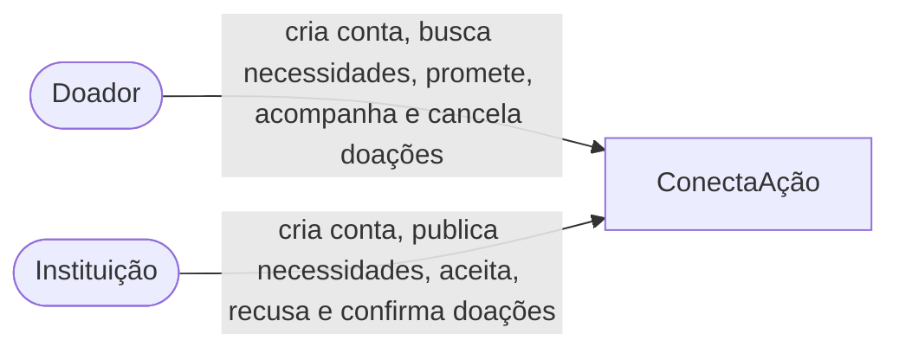
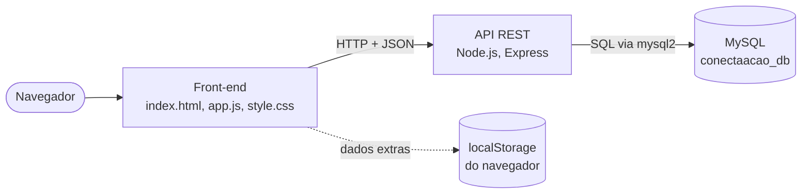
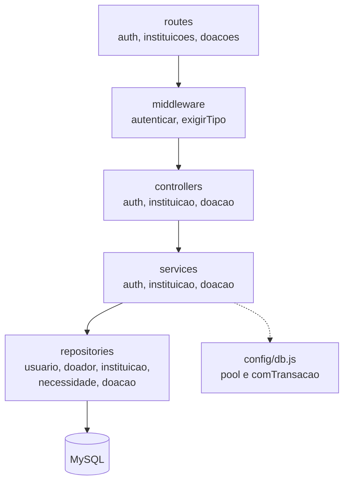
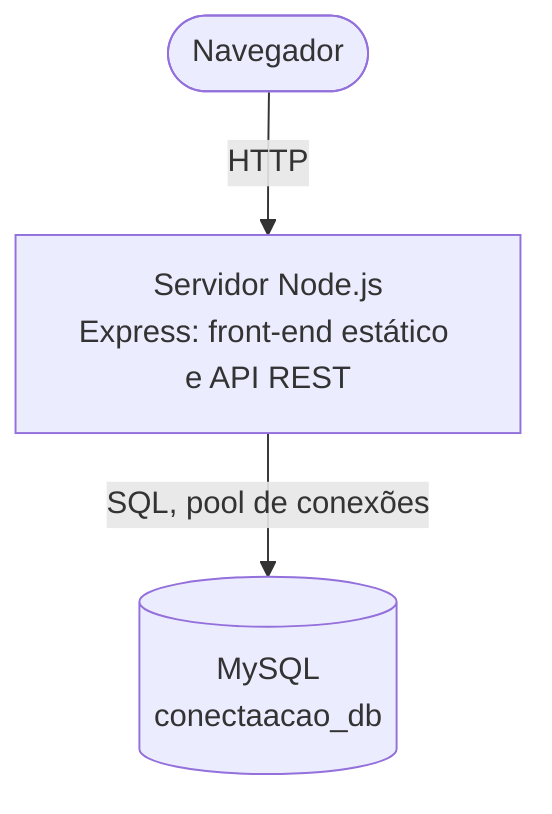

# Arquitetura de software

Artefato central da Sprint 6, atualizado na entrega final. Mostra as partes da aplicação, o que cada uma faz e como se comunicam. As decisões internas do back-end estão em [`decisoes-de-projeto.md`](../projeto/decisoes-de-projeto.md) e [`padroes-de-projeto.md`](../padroes/padroes-de-projeto.md).

## 1. Visão geral

**Estilo:** cliente-servidor com API REST e JSON. O back-end é dividido em camadas: rotas, controllers, services, repositories e banco.

**Por quê:** as regras que mais importam ficam no back-end: não doar mais do que falta, manter o saldo certo com doações simultâneas e restringir o acesso por tipo de usuário. O front-end só consome a API. Cada camada tem uma responsabilidade: o SQL fica nos repositories, as regras e transações nos services e o HTTP nos controllers. Assim dá para testar e mudar uma parte sem mexer nas outras.

Atributos de qualidade atendidos: consistência dos dados (transação com trava de linha), segurança (JWT e senha com hash) e manutenibilidade (camadas com responsabilidade única).

## 2. Diagrama de contexto

O ConectaAção não depende de serviços externos (e-mail, pagamento ou mapas). Os dois tipos de usuário entram com e-mail e senha:

- **Doador:** cria conta, busca instituições e necessidades, promete doações, acompanha e cancela.
- **Instituição:** cria conta, publica necessidades e responde às doações recebidas.

## 3. Diagrama de contêineres e componentes

### 3.1 Contêineres

O `localStorage` guarda o token da sessão e os dados que o banco não tem: cidade, causa, contato, tipo, prioridade e descrição das necessidades. Esses dados valem só para o navegador onde foram salvos.

### 3.2 Componentes da API

Cada elemento corresponde a um arquivo ou pasta da seção 9.

## 4. Componentes e responsabilidades

| Componente | Responsabilidade | Tecnologia | Diretório | Comunicação |
|---|---|---|---|---|
| Front-end | Página única com as telas de doador e de instituição. Guarda o token e os dados extras no navegador. | HTML, CSS e JavaScript puro (`fetch`) | [`src/front/`](../../src/front/) | HTTP + JSON com a API |
| Rotas | Ligam URL e método HTTP ao controller: `/cadastro/*`, `/login`, `/logout`, `/instituicoes/*` e `/doacoes/*` | Express Router | [`src/back/src/routes/`](../../src/back/src/routes/) | Chamam middleware e controllers |
| Middleware | Valida o JWT e exige o tipo de usuário (`doador` ou `instituicao`) | `jsonwebtoken` | [`autenticacao.js`](../../src/back/src/middleware/autenticacao.js) | Roda antes do controller |
| Controllers | Leem o pedido, validam o formato e montam a resposta | Node.js | [`src/back/src/controllers/`](../../src/back/src/controllers/) | Chamam os services |
| Services | Regras de negócio e transações: cadastro, login, consulta de instituições, nova necessidade, doação, cancelamento e respostas da instituição | Node.js, `bcryptjs`, `jsonwebtoken` | [`src/back/src/services/`](../../src/back/src/services/) | Chamam os repositories |
| Repositories | Único lugar com SQL; um módulo por tabela | `mysql2/promise` | [`src/back/src/repositories/`](../../src/back/src/repositories/) | SQL para o MySQL |
| Config e utilitários | Variáveis de ambiente, pool, transação, erros e validações | `dotenv`, `mysql2` | [`config/`](../../src/back/src/config/), [`utils/`](../../src/back/src/utils/) | Usados por todas as camadas |
| Banco | Usuários, doadores, instituições, necessidades e doações, com chaves estrangeiras e `CHECK` de saldo e status | MySQL 8.0.16+ (InnoDB) | [`schema.sql`](../../src/back/sql/schema.sql) | Pool de até 10 conexões |

## 5. Decisões arquiteturais

### DA-01: Camadas no back-end

- **Contexto:** a API reúne HTTP, regras e acesso a dados. Misturar tudo dificultaria testes e manutenção.
- **Decisão:** separar em rotas, controllers, services e repositories. Os services não conhecem `req` e `res` e não escrevem SQL.
- **Atributos:** manutenibilidade e testabilidade.
- **Consequências:** cada mudança fica localizada, e as regras são testadas sem subir o servidor. Em troca, há mais arquivos.
- **Evidência:** [`src/back/src/`](../../src/back/src/)

### DA-02: Cliente-servidor com API REST e front-end estático

- **Contexto:** a interface precisa usar as mesmas regras da API, sem duplicá-las.
- **Decisão:** o front-end é um conjunto de arquivos estáticos que chama a API com `fetch`. As respostas são JSON, e os erros vêm como `{ "erro": "..." }`.
- **Atributos:** simplicidade e compatibilidade (`RNF-09`).
- **Consequências:** não há etapa de build. Sem framework, o `app.js` monta o HTML à mão, com escape de todo texto.
- **Evidência:** [`src/front/app.js`](../../src/front/app.js)

### DA-03: Autenticação sem estado com JWT

- **Contexto:** a API precisa saber quem é o usuário e se ele é doador ou instituição, sem guardar sessão.
- **Decisão:** o login devolve um JWT (HS256, 8 h por padrão) com `id`, `tipo` e `perfilId`. As rotas usam o `perfilId` do token, nunca um id do corpo. As senhas são gravadas com bcrypt.
- **Requisitos:** `RF-05`, `RNF-03`, `RNF-04`.
- **Consequências:** o servidor não guarda sessão. Em troca, o logout só descarta o token no navegador, e um token roubado vale até expirar.
- **Evidência:** [`authService.js`](../../src/back/src/services/authService.js), [`autenticacao.js`](../../src/back/src/middleware/autenticacao.js)

### DA-04: Transação com trava de linha nas doações

- **Contexto:** duas doações ao mesmo tempo para a mesma necessidade poderiam passar do saldo.
- **Decisão:** o `doacaoService` abre uma transação, lê o saldo com `SELECT ... FOR UPDATE`, valida, grava a doação e reduz o saldo. Cancelar e recusar também travam a doação e a necessidade antes de devolver o saldo. Qualquer falha desfaz tudo. O banco reforça a regra com `CHECK (quantidadeFaltante <= quantidadeTotal)`.
- **Requisitos:** `RF-19`, `RF-21`, `RF-23`, `RNF-06`.
- **Consequências:** o saldo fica certo com acessos simultâneos. Doações para a mesma necessidade esperam umas pelas outras, o que é aceitável no volume esperado.
- **Evidência:** [`doacaoService.js`](../../src/back/src/services/doacaoService.js), [`necessidadeRepository.js`](../../src/back/src/repositories/necessidadeRepository.js), [`doacaoRepository.js`](../../src/back/src/repositories/doacaoRepository.js)

### DA-05: Front-end servido pelo Express

- **Contexto:** front e API precisam conversar no navegador, e a API não habilita CORS.
- **Decisão:** servir a pasta do front-end com `express.static`, na mesma origem da API.
- **Atributos:** simplicidade de implantação.
- **Consequências:** um processo e uma URL, sem CORS. Front e back não são publicados separadamente.
- **Evidência:** `app.use(express.static(...))` em [`server.js`](../../src/back/src/server.js)

### DA-06: Dados extras no navegador

- **Contexto:** as telas do protótipo usam cidade, causa, contato, tipo e prioridade, mas o banco não tem essas colunas.
- **Decisão:** o `app.js` guarda esses dados no `localStorage`, ligados ao id real da instituição ou da necessidade. Busca e filtros rodam no navegador.
- **Requisitos:** `RF-07` a `RF-10`, `RF-14`.
- **Consequências:** as telas funcionam sem mudar o banco. Em troca, os dados não são compartilhados entre navegadores e não têm teste automatizado.
- **Evidência:** `lerExtras` e `salvarExtras` em [`app.js`](../../src/front/app.js)

## 6. Requisitos não funcionais e decisões

| RNF | Como é atendido | Decisão |
|---|---|---|
| `RNF-03` Segurança | Senha com bcrypt; JWT com segredo no `.env` | `DA-03` |
| `RNF-04` Privacidade | Listagem e detalhe exigem token | `DA-03` |
| `RNF-05` Sem pagamento | Nenhum serviço externo e nenhum campo de pagamento | `DA-01` |
| `RNF-06` Integridade | Transação com trava de linha | `DA-04` |
| `RNF-09` Compatibilidade | HTML, CSS e JS padrão, sem build. Não verificado em vários navegadores. | `DA-02` |

`RNF-02` (responsividade), `RNF-08` (desempenho) e `RNF-10` (acessibilidade) não foram verificados.

## 7. Implantação e execução

**Configuração (`src/back/.env`):** `JWT_SECRET` (obrigatório), `PORT` (padrão 3000), `JWT_EXPIRES_IN` (padrão 8h), `DB_HOST`, `DB_PORT`, `DB_USER`, `DB_PASSWORD` e `DB_NAME` (padrão `conectaacao_db`).

| Ambiente | Como acessar | Finalidade |
|---|---|---|
| Local | Criar o banco com `sql/schema.sql`, configurar o `.env` e rodar `npm start` em `src/back`. Abrir `http://localhost:3000`. A rota `/teste-conexao` confirma a ligação com o banco. | Desenvolvimento e testes |
| Publicado | Ver [`entrega-final.md`](../entrega-final.md) | Demonstração |

## 8. Riscos arquiteturais

| Risco | Probabilidade | Impacto | Mitigação | Issue |
|---|---|---|---|---|
| Dados extras só no navegador: outro navegador não vê cidade, causa e contato | Alta | Média | Levar esses campos para o banco | sem Issue |
| A tela "Explorar" busca o detalhe de cada instituição para montar a lista de necessidades | Média | Baixa | Criar uma rota que liste as necessidades | sem Issue |
| Token no `localStorage` fica exposto se houver XSS | Média | Alta | Todo texto passa por `esc()` antes de entrar no HTML; avaliar cookie `HttpOnly` | sem Issue |
| Logout não invalida o token no servidor | Média | Média | Expiração curta; avaliar lista de tokens revogados | sem Issue |
| `JWT_SECRET` fraco ou ausente | Baixa | Alta | A API não inicia sem o segredo; usar valor longo e aleatório | sem Issue |
| Não existe fluxo para verificar uma instituição (`verificada` fica sempre falso) | Média | Média | Criar papel de administrador | [#7](https://github.com/gigi-zacaroni/tp-eng-software/issues/7) |
| Doações para a mesma necessidade esperam a trava de linha | Baixa | Baixa | Aceitável no volume atual | sem Issue |

## 9. Correspondência arquitetura × código

| Elemento | Evidência |
|---|---|
| Front-end | [`index.html`](../../src/front/index.html), [`app.js`](../../src/front/app.js), [`style.css`](../../src/front/style.css) |
| API REST (Express) | [`server.js`](../../src/back/src/server.js) |
| Rotas | [`auth.js`](../../src/back/src/routes/auth.js), [`instituicoes.js`](../../src/back/src/routes/instituicoes.js), [`doacoes.js`](../../src/back/src/routes/doacoes.js) |
| Middleware | [`autenticacao.js`](../../src/back/src/middleware/autenticacao.js) |
| Controllers | [`authController.js`](../../src/back/src/controllers/authController.js), [`instituicaoController.js`](../../src/back/src/controllers/instituicaoController.js), [`doacaoController.js`](../../src/back/src/controllers/doacaoController.js) |
| Services | [`authService.js`](../../src/back/src/services/authService.js), [`instituicaoService.js`](../../src/back/src/services/instituicaoService.js), [`doacaoService.js`](../../src/back/src/services/doacaoService.js) |
| Repositories | [`src/back/src/repositories/`](../../src/back/src/repositories/) |
| Pool e transações | [`db.js`](../../src/back/src/config/db.js) |
| Variáveis de ambiente | [`env.js`](../../src/back/src/config/env.js) |
| Banco MySQL | [`schema.sql`](../../src/back/sql/schema.sql) |
