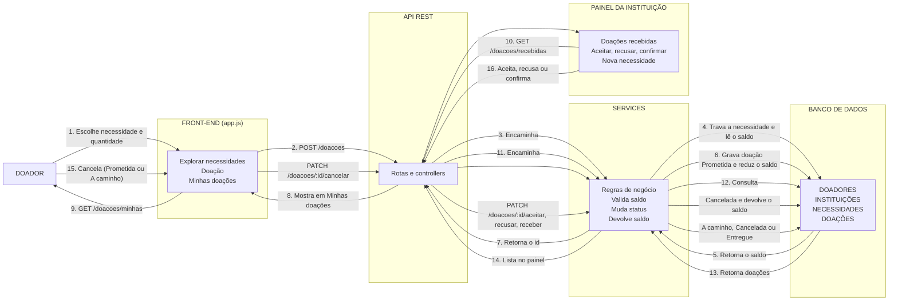
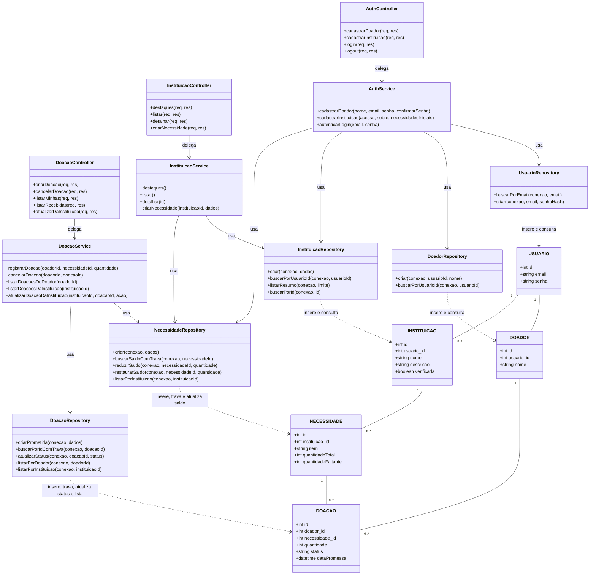

# Modelagem do sistema

Artefato central da Sprint 3, atualizado nas Sprints 4 e 5 e na entrega final.

Os dois modelos abaixo cobrem o **fluxo de doação** (comportamental) e o **domínio persistido com a organização do código** (estrutural). A lista de requisitos está em [`requisitos.md`](../requisitos/requisitos.md), e o vínculo requisito, modelo e código está na [matriz de rastreabilidade](../rastreabilidade.md).

## 1. Modelos selecionados

| Modelo | Tipo | Pergunta que responde | Requisitos |
|---|---|---|---|
| Fluxo de doação entre doador, aplicação e instituição | Comportamental | Como uma doação vai da promessa do doador até a confirmação da instituição? | `RF-19` a `RF-24` |
| Diagrama de classes (domínio e camadas) | Estrutural | Como as entidades se relacionam no banco e como o código se organiza para usá-las? | `RF-01`, `RF-02`, `RF-14`, `RF-18` a `RF-23` |

O comportamental cobre o fluxo que dá nome ao produto e é o único que passa pelos dois perfis. O estrutural mostra as restrições de dados (`RNF-06`) e a separação entre rotas, controllers, services e repositories.

## 2. Modelo comportamental

**Descrição**

O doador escolhe uma necessidade e a quantidade. A API encaminha o pedido ao service, que trava a linha da necessidade, confere o saldo, grava a doação como `Prometida` e reduz o saldo na mesma transação. O doador acompanha a doação em "Minhas doações".

A instituição vê as doações no painel. Ela aceita (`A caminho`), recusa (`Cancelada`, com devolução do saldo) ou confirma o recebimento (`Entregue`). O doador só cancela, e só em `Prometida` ou `A caminho`. Ele não muda o status para `A caminho` ou `Entregue` (`RN-04`).

Até a Sprint 8, as arestas 15 e 16 eram tracejadas porque não tinham código. Na entrega final as duas foram implementadas, e a aresta 15 passou a representar só o cancelamento.

## 3. Modelo estrutural

**Descrição**

O diagrama começou como um modelo ER na Sprint 3 e virou diagrama de classes na Sprint 4, para mostrar as camadas. A Sprint 5 acrescentou os repositories ([`DP-04`](../projeto/decisoes-de-projeto.md#dp-04-camada-de-repositories-padrão-repository) e [`padroes-de-projeto.md`](../padroes/padroes-de-projeto.md)). Na entrega final entraram o controller e o service de instituição e os métodos de listagem e mudança de status.

`DOACAO` liga `DOADOR` a `NECESSIDADE` e guarda a quantidade, o status e a data da promessa. O `status` aceita `Prometida`, `A caminho`, `Entregue` e `Cancelada` (`CHECK` no schema).

Cidade, causa, contato, tipo e prioridade não aparecem no modelo porque não estão no banco. O front guarda esses dados no navegador (ver [`src/front/README.md`](../../src/front/README.md)).

### Quatro decisões de modelagem

1. **Controllers separados dos services.** Os controllers só leem `req` e respondem com `res`. Os services têm as regras e controlam a transação.
2. **Identidade separada do perfil.** `email` e `senha` ficam em `USUARIO`; `nome`, `descricao` e `verificada` ficam nos perfis. Uma tabela única teria colunas nulas em metade das linhas, e o login precisaria saber antes qual perfil consultar.
3. **Saldo guardado, não calculado.** `quantidadeFaltante` é um campo, e não uma soma de `DOACAO`. Assim dá para travar a linha da necessidade na promessa e garantir o `RNF-06` no banco.
4. **Vínculo como entidade.** `DOACAO` tem atributos próprios (`quantidade`, `status`, `dataPromessa`) e por isso não é uma tabela de junção simples.

## 4. Relação entre requisitos e modelos

| Requisito | Elemento do modelo | Como está representado | Código |
|---|---|---|---|
| `RF-01` | `USUARIO` e `DOADOR` | `DOADOR` guarda o nome e referencia `USUARIO`. | `POST /cadastro/doador` |
| `RF-02` | `USUARIO`, `INSTITUICAO` e `NECESSIDADE` | A instituição nasce com `verificada = false` e zero ou mais necessidades. | `POST /cadastro/instituicao` |
| `RF-14` | `NECESSIDADE` | Item, quantidade total e saldo igual ao total. | `POST /instituicoes/necessidades` |
| `RF-18` | `NECESSIDADE.quantidadeTotal` e `quantidadeFaltante` | O prometido é a diferença entre os dois. | `GET /instituicoes/:id` |
| `RF-19` | Arestas 1 a 9 | O service valida o saldo antes de gravar a doação e reduzir o saldo. | `POST /doacoes` |
| `RF-20` | `DOACAO.status`, aresta 9 | O doador vê o status de cada doação. | `GET /doacoes/minhas` |
| `RF-21` | Aresta 15 | Cancelar grava `Cancelada` e devolve a quantidade. | `PATCH /doacoes/:id/cancelar` |
| `RF-22` | Arestas 10 a 14 | A instituição lista as doações das suas necessidades. | `GET /doacoes/recebidas` |
| `RF-23` | Aresta 16 | Aceitar, recusar e confirmar mudam o `status`. | `PATCH /doacoes/:id/aceitar`, `/recusar`, `/receber` |
| `RF-24` | `NECESSIDADE` e soma de `DOACAO` | O recebido seria a soma das doações `Entregue`. | Parcial: a soma não é calculada. |

## 5. Correspondência entre modelo e código

| Elemento | Arquivo | Observação |
|---|---|---|
| Entidades | [`schema.sql`](../../src/back/sql/schema.sql) | Tabelas, chaves estrangeiras, `UNIQUE` e `CHECK` de saldo e status. |
| Controllers | [`authController.js`](../../src/back/src/controllers/authController.js), [`instituicaoController.js`](../../src/back/src/controllers/instituicaoController.js), [`doacaoController.js`](../../src/back/src/controllers/doacaoController.js) | Leem o pedido, validam o formato e devolvem o status HTTP. |
| Services | [`authService.js`](../../src/back/src/services/authService.js), [`instituicaoService.js`](../../src/back/src/services/instituicaoService.js), [`doacaoService.js`](../../src/back/src/services/doacaoService.js) | Regras, hash de senha, JWT e transações. Não escrevem SQL. |
| Repositories | [`src/back/src/repositories/`](../../src/back/src/repositories/) | Único lugar com SQL. Um módulo por entidade. Recebem a conexão e não controlam transação. |
| Rotas | [`auth.js`](../../src/back/src/routes/auth.js), [`instituicoes.js`](../../src/back/src/routes/instituicoes.js), [`doacoes.js`](../../src/back/src/routes/doacoes.js) | Ligam cada URL ao controller e ao middleware de acesso. |
| Acesso | [`autenticacao.js`](../../src/back/src/middleware/autenticacao.js) | `autenticar` valida o JWT; `exigirTipo` separa doador de instituição. |
| Banco | [`db.js`](../../src/back/src/config/db.js) | Pool MySQL e `comTransacao`, que concentra `begin`, `commit` e `rollback`. |
| Erros | [`server.js`](../../src/back/src/server.js), [`http.js`](../../src/back/src/utils/http.js) | Handler central que converte `ErroHttp` e erros do MySQL em respostas JSON. |
| Front do fluxo | [`app.js`](../../src/front/app.js) | Telas de doação, minhas doações e painel da instituição. |

### Divergências entre modelo e código

| Divergência | Situação |
|---|---|
| `DOACAO.dataPromessa` estava no modelo, mas não no schema. | Resolvida na Sprint 4 ([`086991a`](https://github.com/gigi-zacaroni/tp-eng-software/commit/086991a9e908c6b4229169ff140e15112611e1a0)). |
| Havia dois arquivos de schema diferentes. | Resolvida na Sprint 4 ([#19](https://github.com/gigi-zacaroni/tp-eng-software/issues/19)). |
| As arestas 10 a 16 não tinham código. | Resolvida na entrega final. |
| O protótipo prevê causa, cidade e contato da instituição, e o modelo não. | Aberta. O front guarda esses dados no navegador. |
| O protótipo prevê total recebido por necessidade. | Aberta (`RF-24`). |

## 6. Refinamentos identificados

- **Camadas (Sprint 4).** O código misturava banco e resposta HTTP no arquivo de rota. A refatoração criou controllers e services.
- **Acesso a dados (Sprint 5).** O modelo ligava os services direto às entidades, o que no código era SQL dentro da regra de negócio. Os repositories passaram a mediar essa ligação (`DP-04`). O fluxo de doação não mudou: os passos 4 a 6 continuam numa transação.
- **Identidade e perfil.** Separar `USUARIO` dos perfis evitou colunas nulas e simplificou o login. O JWT leva `id`, `tipo` e `perfilId` (`RF-03`).
- **Saldo com trava.** Os passos 4 a 6 precisam ser atômicos, senão dois doadores ao mesmo tempo poderiam passar do saldo. O `SELECT ... FOR UPDATE` e o `CHECK` no banco tratam isso (`RF-19`, `RF-21`, `RNF-06`).
- **Lacuna de leitura (Sprint 3).** As arestas 10 a 14 e os `RF-06` a `RF-10` pediam consultas sem endpoint. Virou o item `T-10`, concluído na Sprint 8.
- **Schema duplicado (Sprint 3).** Dois DDL diferentes deixavam ambíguo o que o modelo representava. Virou o item `T-09`, resolvido na Sprint 4.
- **Quem confirma a entrega (entrega final).** O código permitia que o doador marcasse a própria doação como `Entregue`, o que contrariava o `RN-04`. A rota foi removida, e a aresta 15 passou a ser só o cancelamento.

## 7. Histórico de atualização

| Sprint | Modelo alterado | Motivo | Evidência |
|---|---|---|---|
| Sprint 3 | Estrutural: criação | Domínio traduzido para o modelo físico MySQL. | [`26b7fd1`](https://github.com/gigi-zacaroni/tp-eng-software/commit/26b7fd135624e5c47428425a190b44c7a0420c23) |
| Sprint 3 | Comportamental: etapa de acesso | Cadastro e login validados antes do fluxo de doação. | [`f8a059c`](https://github.com/gigi-zacaroni/tp-eng-software/commit/f8a059ce6edf8a187866540f09f167f8134ebca2), [`2e888a1`](https://github.com/gigi-zacaroni/tp-eng-software/commit/2e888a12a801469910edb78800ee6c6f49f32392), [`a8c2ff2`](https://github.com/gigi-zacaroni/tp-eng-software/commit/a8c2ff26f4425aa24d986e1c4e7efe630b5d5ff7), [`0a85290`](https://github.com/gigi-zacaroni/tp-eng-software/commit/0a852902cb4954238172f966bcd244479d22fbf6) |
| Sprint 3 | Ambos: reorganização do back-end | Código dividido em `config/`, `middleware/`, `routes/` e `utils/`. | [`d72574c`](https://github.com/gigi-zacaroni/tp-eng-software/commit/d72574c4cf49a529badbd6d8858ceec19492998f) |
| Sprint 3 | §5 e §6 | Caminhos de arquivo corrigidos e divergências registradas. | [`ca58383`](https://github.com/gigi-zacaroni/tp-eng-software/commit/ca58383) |
| Sprint 4 | Estrutural e §4 a §6 | Camadas de rotas, controllers e services. | [`086991a`](https://github.com/gigi-zacaroni/tp-eng-software/commit/086991a9e908c6b4229169ff140e15112611e1a0), [`280e744`](https://github.com/gigi-zacaroni/tp-eng-software/commit/280e74448e844ec5549bf79638d6a03e3aa0ae62) |
| Sprint 4 | §3 e §5 | Nomes de classes e links ajustados aos arquivos reais. | [`sprint-04.md`](../sprints/sprint-04.md) |
| Sprint 5 | Estrutural e §3, §5, §6 | Camada de repositories. | [`fa515a9`](https://github.com/gigi-zacaroni/tp-eng-software/commit/fa515a9f36ab5306bf0011052301527ba26fae87) |
| Entrega final | Ambos e §4 a §6 | Arestas 10 a 16 implementadas; controller e service de instituição; métodos novos dos repositories; `USUARIO.papel` removido, porque não existe no schema; doador sem avanço de status. | `d393149`, `3ba1f81` |
