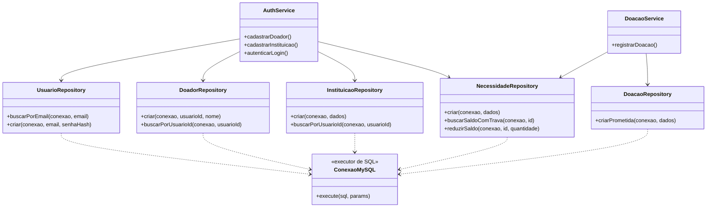
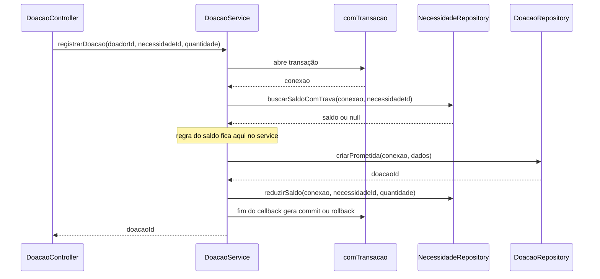

# Padrões de projeto aplicados

> **Artefato central da Sprint 5.** Padrão adotado: **Repository** (`PP-01`). Os links de código usam a tag `sprint-05`, que passa a existir quando o grupo publicar a tag. Itens que só o grupo pode preencher (número de Issue, hash de commit) estão marcados com `[PREENCHER]`.

## 1. Problema recorrente identificado

Depois da refatoração em camadas da Sprint 4 ([DP-01](../projeto/decisoes-de-projeto.md#2-registro-de-decisões)), as rotas e os controllers ficaram limpos, mas **os dois services passaram a carregar o SQL junto com a regra de negócio**. A análise da §4 de `decisoes-de-projeto.md` já apontava `authService.js` como "o arquivo mais pesado" e abriu o item `T-17` ("tirar o SQL de dentro dos services").

O que existia no código antes desta sprint (contagem feita no código entregue ao fim da Sprint 4, antes das mudanças desta sprint):

| Onde | Instruções SQL dentro do service | Tabelas tocadas |
|---|---|---|
| `services/authService.js` | 8 (`criarUsuario` 2 · `cadastrarDoador` 1 · `cadastrarInstituicao` 2 · `autenticarLogin` 3) | `usuarios`, `doadores`, `instituicoes`, `necessidades` |
| `services/doacaoService.js` | 3 (`SELECT ... FOR UPDATE`, `INSERT`, `UPDATE`) | `necessidades`, `doacoes` |
| **Total** | **11** | **5 (todas)** |

Trecho do problema, em `doacaoService.registrarDoacao` (antes):

```js
const [necessidade] = await conexao.execute(
  'SELECT quantidadeFaltante FROM necessidades WHERE id = ? FOR UPDATE',
  [necessidadeId]
);
if (necessidade.length === 0) {                      // forma do resultado do driver
  throw new ErroHttp(404, 'Necessidade não encontrada.');
}
if (quantidade > necessidade[0].quantidadeFaltante) { // nome de coluna do banco
  throw new ErroHttp(400, 'Quantidade doada é maior que a necessária.');
}
```

A regra de negócio ("não prometer mais do que falta") está misturada com o formato que o `mysql2` devolve (`[linhas]`, `.length`, `[0].coluna`) e com o nome físico da coluna. Isso causou problemas concretos:

1. **A regra não pode ser testada sem simular SQL.** Para escrever os testes de caracterização desta sprint foi preciso criar um banco falso que reconhece cada instrução pelo texto ([`tests/helpers/bancoFalso.js`](../../src/back/tests/helpers/bancoFalso.js)). Testar "saldo insuficiente devolve 400" exigia conhecer o SQL.
2. **A mesma consulta aparecia escrita duas vezes com colunas diferentes.** O cadastro verificava e-mail com `SELECT id FROM usuarios WHERE email = ?` e o login fazia `SELECT id, senha FROM usuarios WHERE email = ?`. Mudar a tabela `usuarios` obrigava a lembrar dos dois pontos.
3. **O SQL das cinco tabelas estava espalhado por dois arquivos de regra.** O item `T-10` (endpoints `GET` de instituições e necessidades) vai precisar de mais consultas sobre `instituicoes` e `necessidades`; sem um lugar próprio, elas cairiam nos services ou nos controllers, desfazendo a separação da `DP-01`.
4. **O service conhecia detalhes do driver** (`insertId`, desestruturação `[linhas]`), o que o prende ao `mysql2`.

## 2. Padrão aplicado

### PP-01 — Repository

- **Problema que resolve:** regra de negócio dos services misturada com SQL e com o formato de resposta do driver (§1).
- **Contexto no projeto:** camada de persistência entre os services e o MySQL, para as cinco tabelas do [schema](../../src/back/sql/schema.sql).
- **Participantes do padrão no código:** ver §5.
- **Requisitos relacionados:** `RF-01`, `RF-02`, `RF-03`, `RF-14`, `RF-18`, `RF-19`, `RNF-06`.
- **Decisão registrada em:** [`DP-04`](../projeto/decisoes-de-projeto.md#dp-04--camada-de-repositories-padrão-repository).
- **Issue/PR:** `[PREENCHER — Issue T-17 (implementação) e T-18 (validação)]`.

**Como o padrão foi aplicado, sem mudar as responsabilidades já decididas:**

- O **service** continua dono da regra, da validação e da **transação** (`comTransacao`). A atomicidade e o `SELECT ... FOR UPDATE` da `DP-02` seguem sob controle dele.
- O **repository** recebe o executor de SQL como primeiro parâmetro (`conexao`): ou uma conexão de transação, ou o `pool` para consultas simples. Ele nunca abre nem encerra transação.
- A **regra do saldo** ("quantidade > saldo ⇒ 400") não foi para o repository. O repository só lê e escreve (`buscarSaldoComTrava`, `reduzirSaldo`).

## 3. Estrutura do padrão



Fluxo da promessa de doação (`RF-19`) com o padrão, mostrando quem controla a transação:


## 4. Evidência no código

| Papel no padrão | Arquivo/módulo | Link |
|---|---|---|
| Cliente (regra de negócio e transação) | `services/authService.js` | [código](https://github.com/gigi-zacaroni/tp-eng-software/blob/sprint-05/src/back/src/services/authService.js) |
| Cliente (regra de negócio e transação) | `services/doacaoService.js` | [código](https://github.com/gigi-zacaroni/tp-eng-software/blob/sprint-05/src/back/src/services/doacaoService.js) |
| Repository de `usuarios` | `repositories/usuarioRepository.js` | [código](https://github.com/gigi-zacaroni/tp-eng-software/blob/sprint-05/src/back/src/repositories/usuarioRepository.js) |
| Repository de `doadores` | `repositories/doadorRepository.js` | [código](https://github.com/gigi-zacaroni/tp-eng-software/blob/sprint-05/src/back/src/repositories/doadorRepository.js) |
| Repository de `instituicoes` | `repositories/instituicaoRepository.js` | [código](https://github.com/gigi-zacaroni/tp-eng-software/blob/sprint-05/src/back/src/repositories/instituicaoRepository.js) |
| Repository de `necessidades` (com a trava do saldo) | `repositories/necessidadeRepository.js` | [código](https://github.com/gigi-zacaroni/tp-eng-software/blob/sprint-05/src/back/src/repositories/necessidadeRepository.js) |
| Repository de `doacoes` | `repositories/doacaoRepository.js` | [código](https://github.com/gigi-zacaroni/tp-eng-software/blob/sprint-05/src/back/src/repositories/doacaoRepository.js) |
| Fonte de dados e controle de transação | `config/db.js` (`pool`, `comTransacao`), **sem alteração** | [código](https://github.com/gigi-zacaroni/tp-eng-software/blob/sprint-05/src/back/src/config/db.js) |

Rotas, controllers, middleware, `server.js` e `schema.sql` **não foram alterados**. O comportamento externo da API é o mesmo.


## 5. Alternativas e justificativas 

| Alternativa | Vantagem | Limitação no contexto do projeto |
|---|---|---|
| **A. Não usar padrão** (manter o SQL nos services) | Nenhum arquivo novo. O sistema é pequeno: 2 services, 5 tabelas, 11 instruções. | Mantém os quatro problemas da §1. O `T-10` vai aumentar o SQL nos services justamente na sprint seguinte. A própria análise da Sprint 4 já tratou isso como melhoria a fazer (`T-17`). |
| **B. ORM ou query builder** (Sequelize, Knex) | Elimina SQL escrito à mão. | Nova dependência e nova curva de aprendizado a poucas semanas da entrega, depois de a stack já ter mudado na Sprint 3. O controle fino de `SELECT ... FOR UPDATE` e da transação ([DP-02](../projeto/decisoes-de-projeto.md#2-registro-de-decisões)) ficaria mais difícil de enxergar. |
| **C. Um único `queries.js` com todas as consultas** | Tira o SQL dos services com pouco esforço. | Só muda o SQL de lugar. O service continuaria interpretando `[linhas]` e `insertId`, e o arquivo viraria um depósito sem fronteira por entidade. |
| **D. Active Record** (persistência dentro das entidades) | Reúne dado e persistência. | O projeto não tem classes de entidade; os dados são objetos simples. Criaria uma camada de modelos só para esse fim. |
| **E. Repository por entidade (escolhida)** | Um módulo por tabela, com operações nomeadas pela intenção de negócio, devolvendo valores simples. Cabe no código atual sem dependência nova. | Mais arquivos e uma indireção a mais (ver §6). |

Em termos estritos, as funções criadas ficam entre um DAO e um Repository. Adotamos o nome **Repository** porque as operações são nomeadas pela intenção de domínio (`buscarSaldoComTrava`, `criarPrometida`) e entregam valores de domínio (`null`, um número, um perfil) em vez de linhas cruas do driver. Um DAO genérico (`select`, `insert`, `update`) não resolveria o problema 1.

## 6. Resultado observado

**Benefícios**

- Os services passaram a descrever só a regra: validar, decidir, chamar. A ordem "trava → confere → cria → abate" da `DP-02` fica legível em cinco linhas.
- Cada tabela tem um único dono do SQL. Os endpoints `GET` do `T-10` entram em `instituicaoRepository` e `necessidadeRepository`, sem tocar nos services de escrita.
- O service deixou de depender do formato do `mysql2`.
- Duas consultas duplicadas viraram uma.


## 7. Padrões avaliados e não aplicados

| Padrão | Por que não foi necessário ou adequado |
|---|---|
| Strategy | Não há variação de algoritmo em tempo de execução. O único ponto parecido (cadastro de doador × instituição) são dois fluxos com dados diferentes, não duas formas de fazer a mesma coisa. |
| Factory Method | Não existe hierarquia de objetos a instanciar. Doador e instituição são linhas de tabelas diferentes, sem classes. |
| Unit of Work | `comTransacao` já agrupa as operações em uma transação. Formalizar um Unit of Work só para esconder isso do service seria camada extra sem ganho hoje (limitação 1 da §7). Pode voltar a ser avaliado se a Sprint 6 mexer na arquitetura. |
| Observer | Seria adequado para as notificações (`RF-25` a `RF-27`), mas esses requisitos ainda não têm código. Aplicá-lo agora seria um padrão sem problema real. |
| Singleton | O `pool` de conexões já é compartilhado pelo cache de módulos do Node. Não foi implementado nada para isso, então não registramos como padrão aplicado. |

